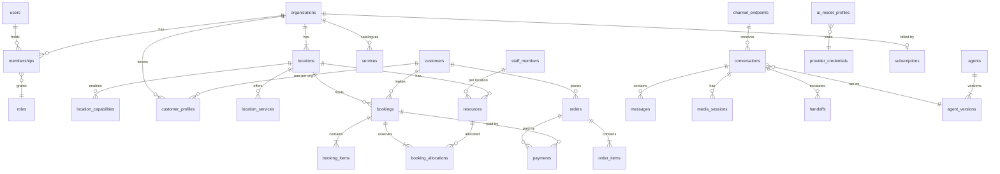

# Data model

The single source of truth for persistence: every table, column, constraint and index.
Implementation: Drizzle schemas per module plus SQL migrations
([BACKEND.md §7](../../BACKEND.md#7-multi-tenancy-and-data-access)). The model covers all
planned capabilities ([roadmap](../product/roadmap.md)); tables are created in the phase
that first needs them (column **Phase** in the catalogue).

---

## 1. Conventions

### 1.1 Naming

- Tables: plural `snake_case` (`booking_allocations`). Join tables: `<a>_<b>` in
  singular-plural form (`membership_locations`).
- Columns: `snake_case`. Foreign keys: `<referenced_singular>_id`. Booleans: `is_*` /
  `has_*` / past-tense verbs only for timestamps (`confirmed_at`).
- Constraints and indexes: `<table>_<columns>_<pk|fk|uq|idx|ck|ex>`.

### 1.2 Standard column groups

To avoid repeating them, tables below reference these groups:

| Group | Columns | Applies to |
|---|---|---|
| **[base]** | `id uuid PK` (UUIDv7, app-generated), `created_at timestamptz NOT NULL DEFAULT now()`, `updated_at timestamptz NOT NULL DEFAULT now()` | every table except pure join tables and append-only logs (those have `id` + `created_at` only, noted as **[base-append]**) |
| **[tenant]** | `organization_id uuid NOT NULL FK → organizations`, RLS `tenant_isolation` policy, every index leads with it | every tenant-owned table |
| **[location]** | `location_id uuid NOT NULL FK → locations` (same organization enforced by composite FK where noted) | location-scoped tables |
| **[soft]** | `deleted_at timestamptz NULL`; partial unique indexes `WHERE deleted_at IS NULL` | user-managed configuration (services, products, staff, resources…) — never transactional records |
| **[ver]** | `version integer NOT NULL DEFAULT 1`, incremented on every update; used for `ETag`/`If-Match` | configuration edited concurrently from the dashboard |
| **[i18n]** | `translations jsonb NOT NULL DEFAULT '{}'` — `{ "<locale>": { "<field>": "<text>" } }`; the base columns hold the organization's default locale | translatable business content |
| **[meta]** | `metadata jsonb NOT NULL DEFAULT '{}'` — integrator-owned key/values (max 50 keys, string values) | entities exposed in the public API |
| **[actor]** | `<verb>_by_type text` (`user` / `customer` / `agent` / `platform_admin` / `system` / `api_key`) + `<verb>_by_id uuid NULL` | who performed an action |

### 1.3 Types

| Concept | Postgres type | Notes |
|---|---|---|
| Identifiers | `uuid` | UUIDv7 → time-ordered, index-friendly; never exposed sequences |
| Instants | `timestamptz` | Always UTC |
| Local wall time | `time` | Interpreted in the owner location's timezone |
| Calendar date | `date` | Interpreted in the owner location's timezone |
| Time ranges | `tstzrange` `[start, end)` | Used where overlap must be enforced |
| Timezone | `text` | IANA name (`Asia/Karachi`), validated by app |
| Money | `bigint` `*_minor` + `currency char(3)` | ISO 4217; minor units per currency exponent |
| Percentages / rates | `integer` basis points (`*_bps`) | 1250 = 12.50% |
| Phone | `text` E.164 | Validated with libphonenumber |
| Email | `citext` | Case-insensitive uniqueness |
| Enumerations | `text` + `CHECK (col IN (...))` | Values defined once in `packages/contracts`; text + check is cheaper to evolve than PG enums |
| Flexible structured data | `jsonb` | Always validated by a Zod schema before write; never used for data we filter or join on frequently |
| Locale | `text` BCP 47 (`en`, `en-GB`, `ur-PK`) | |
| Country | `char(2)` ISO 3166-1 alpha-2 | |
| Embeddings | `vector(n)` | pgvector; dimension per embedding model profile |
| Secrets | `bytea` ciphertext | Envelope encrypted ([BACKEND.md §12](../../BACKEND.md#12-configuration-and-secrets)) |
| Hashes | `bytea` (SHA-256) or `text` (Argon2id encoded) | Tokens and OTPs are only ever stored hashed |

### 1.4 Deletion and history

- **Configuration** (services, staff, products…) is soft-deleted ([soft]) so historic
  bookings and orders keep valid references.
- **Transactional records** (bookings, orders, payments, conversations) are never
  deleted by users; they change status. Privacy deletion **anonymizes** personal fields
  ([NFR-PRIV-001](../product/requirements.md#nfr-priv--privacy-and-compliance)).
- **History** of transactional records lives in append-only `*_events` tables
  (`booking_events`, `order_events`, `conversation_events`) and `audit_logs`.
- **Snapshots:** bookings and orders copy names, prices and policy rules at creation
  (`*_snapshot` columns), so later catalogue edits never rewrite history.

### 1.5 Multi-tenancy

- Every [tenant] table has RLS enabled and forced ([BACKEND.md §7.2](../../BACKEND.md#72-rls-policies)).
- Where a child must belong to the same organization as its parent, the FK is composite:
  `(organization_id, location_id) → locations(organization_id, id)` (parents expose a
  `UNIQUE (organization_id, id)`). This makes cross-tenant references impossible even by
  a bug.
- Global tables (no [tenant]): `platform_admins`, `users`, `customers`, `sessions`,
  `refresh_tokens`, `auth_challenges`, `mfa_factors`, `oauth_accounts`, `plans`,
  `plan_prices`, `usage_meters`, `plan_usage_allowances`, `feature_flags`, and
  platform-scope rows of `provider_credentials`, `ai_model_profiles`,
  `notification_templates`.

### 1.6 Partitioning

High-volume append tables are range-partitioned by month on their time column, created
ahead by the `partition-maintain` job: `messages`, `conversation_events`, `audit_logs`,
`notifications`, `usage_records`, `outbox_events` (published rows pruned),
`inbound_webhook_events`. Primary keys on partitioned tables include the partition key
(`PRIMARY KEY (id, created_at)`).

### 1.7 Extensions

`btree_gist` (exclusion constraints mixing `=` and `&&`), `citext`, `vector`. PostGIS is
not required initially: delivery zones use radius checks in SQL and polygon checks in the
app ([ADR-0001](../adr/0001-postgresql.md)); PostGIS can be added later without schema
breakage (columns are GeoJSON `jsonb` + `lat`/`lng`).

---

## 2. Domain map

---

## 3. Table catalogue

| Table | Doc | Owner module | Scope | Phase |
|---|---|---|---|---|
| `platform_admins` | [01](01-identity-and-auth.md#platform_admins) | platform-admins | global | 0 |
| `users` | [01](01-identity-and-auth.md#users) | users | global | 0 |
| `customers` | [01](01-identity-and-auth.md#customers) | customers | global | 1 |
| `sessions` | [01](01-identity-and-auth.md#sessions) | auth | global | 0 |
| `refresh_tokens` | [01](01-identity-and-auth.md#refresh_tokens) | auth | global | 4 |
| `auth_challenges` | [01](01-identity-and-auth.md#auth_challenges) | auth | global | 0 |
| `mfa_factors` | [01](01-identity-and-auth.md#mfa_factors) | auth | global | 0 |
| `oauth_accounts` | [01](01-identity-and-auth.md#oauth_accounts) | auth | global | 2 |
| `impersonation_sessions` | [01](01-identity-and-auth.md#impersonation_sessions) | platform-admins | global | 2 |
| `organizations` | [02](02-tenancy-and-access.md#organizations) | organizations | tenant root | 0 |
| `locations` | [02](02-tenancy-and-access.md#locations) | locations | tenant | 0 |
| `location_capabilities` | [02](02-tenancy-and-access.md#location_capabilities) | locations | tenant | 0 |
| `roles` | [02](02-tenancy-and-access.md#roles) | access | tenant / system | 0 |
| `memberships` | [02](02-tenancy-and-access.md#memberships) | access | tenant | 0 |
| `membership_locations` | [02](02-tenancy-and-access.md#membership_locations) | access | tenant | 0 |
| `invitations` | [02](02-tenancy-and-access.md#invitations) | access | tenant | 0 |
| `api_keys` | [02](02-tenancy-and-access.md#api_keys) | api-keys | tenant | 4 |
| `customer_profiles` | [03](03-customers.md#customer_profiles) | customers | tenant | 1 |
| `customer_addresses` | [03](03-customers.md#customer_addresses) | customers | global (customer-owned) | 3 |
| `consents` | [03](03-customers.md#consents) | customers | tenant | 1 |
| `schedules` | [04](04-scheduling-and-resources.md#schedules) | scheduling | tenant | 0 |
| `schedule_intervals` | [04](04-scheduling-and-resources.md#schedule_intervals) | scheduling | tenant | 0 |
| `schedule_exceptions` | [04](04-scheduling-and-resources.md#schedule_exceptions) | scheduling | tenant | 0 |
| `staff_members` | [04](04-scheduling-and-resources.md#staff_members) | scheduling | tenant | 1 |
| `resources` | [04](04-scheduling-and-resources.md#resources) | scheduling | tenant | 1 |
| `resource_groups` | [04](04-scheduling-and-resources.md#resource_groups) | scheduling | tenant | 1 |
| `resource_group_members` | [04](04-scheduling-and-resources.md#resource_group_members) | scheduling | tenant | 1 |
| `resource_combinations` | [04](04-scheduling-and-resources.md#resource_combinations) | scheduling | tenant | 3 |
| `resource_combination_members` | [04](04-scheduling-and-resources.md#resource_combination_members) | scheduling | tenant | 3 |
| `external_busy_blocks` | [04](04-scheduling-and-resources.md#external_busy_blocks) | scheduling | tenant | 2 |
| `service_categories` | [05](05-catalog-and-policies.md#service_categories) | catalog | tenant | 1 |
| `services` | [05](05-catalog-and-policies.md#services) | catalog | tenant | 1 |
| `service_variants` | [05](05-catalog-and-policies.md#service_variants) | catalog | tenant | 1 |
| `location_services` | [05](05-catalog-and-policies.md#location_services) | catalog | tenant | 1 |
| `service_resource_rules` | [05](05-catalog-and-policies.md#service_resource_rules) | catalog | tenant | 1 |
| `policies` | [05](05-catalog-and-policies.md#policies) | catalog | tenant | 1 |
| `forms` | [05](05-catalog-and-policies.md#forms) | catalog | tenant | 2 |
| `form_versions` | [05](05-catalog-and-policies.md#form_versions) | catalog | tenant | 2 |
| `form_responses` | [05](05-catalog-and-policies.md#form_responses) | catalog | tenant | 2 |
| `tax_categories` | [05](05-catalog-and-policies.md#tax_categories) | catalog | tenant | 3 |
| `tax_rates` | [05](05-catalog-and-policies.md#tax_rates) | catalog | tenant | 3 |
| `bookings` | [06](06-bookings.md#bookings) | bookings | tenant | 1 |
| `booking_items` | [06](06-bookings.md#booking_items) | bookings | tenant | 1 |
| `booking_allocations` | [06](06-bookings.md#booking_allocations) | bookings | tenant | 1 |
| `booking_participants` | [06](06-bookings.md#booking_participants) | bookings | tenant | 4 |
| `booking_events` | [06](06-bookings.md#booking_events) | bookings | tenant | 1 |
| `reservation_details` | [06](06-bookings.md#reservation_details) | bookings | tenant | 3 |
| `reservation_turn_rules` | [06](06-bookings.md#reservation_turn_rules) | bookings | tenant | 3 |
| `reservation_pacing_rules` | [06](06-bookings.md#reservation_pacing_rules) | bookings | tenant | 3 |
| `menus` … `order_deliveries` (15 tables) | [07](07-ordering.md) | ordering | tenant | 3 |
| `payment_accounts`, `payments`, `refunds` | [08](08-payments.md) | payments | tenant | 3 |
| `plans` … `usage_records` (12 tables) | [09](09-platform-billing.md) | billing | global / tenant | 2 (`plans` seeded in 0) |
| `phone_numbers` | [10](10-channels-and-conversations.md#phone_numbers) | channels | tenant | 2 |
| `channel_endpoints` | [10](10-channels-and-conversations.md#channel_endpoints) | channels | tenant | 1 |
| `conversations` | [10](10-channels-and-conversations.md#conversations) | conversations | tenant | 1 |
| `media_sessions` | [10](10-channels-and-conversations.md#media_sessions) | conversations | tenant | 1 |
| `messages` | [10](10-channels-and-conversations.md#messages) | conversations | tenant, partitioned | 1 |
| `conversation_events` | [10](10-channels-and-conversations.md#conversation_events) | conversations | tenant, partitioned | 1 |
| `handoff_targets` | [10](10-channels-and-conversations.md#handoff_targets) | handoff | tenant | 2 |
| `handoffs` | [10](10-channels-and-conversations.md#handoffs) | handoff | tenant | 2 |
| `tasks` | [10](10-channels-and-conversations.md#tasks) | tasks | tenant | 2 |
| `provider_credentials` | [11](11-agents-and-ai.md#provider_credentials) | providers | global / tenant (BYOK) | 1 |
| `ai_model_profiles` | [11](11-agents-and-ai.md#ai_model_profiles) | providers | global / tenant (BYOK) | 1 |
| `ai_profile_assignments` | [11](11-agents-and-ai.md#ai_profile_assignments) | providers | global | 1 |
| `agents` | [11](11-agents-and-ai.md#agents) | agents | tenant | 1 |
| `agent_versions` | [11](11-agents-and-ai.md#agent_versions) | agents | tenant | 1 |
| `knowledge_sources` | [11](11-agents-and-ai.md#knowledge_sources) | knowledge | tenant | 1 |
| `knowledge_entries` | [11](11-agents-and-ai.md#knowledge_entries) | knowledge | tenant | 1 |
| `knowledge_chunks` | [11](11-agents-and-ai.md#knowledge_chunks) | knowledge | tenant | 1 |
| `notification_templates`, `notifications`, `push_devices` | [12](12-notifications.md) | notifications | global / tenant | 0 (email only), 2 |
| `integration_connections` … `webhook_deliveries` (5 tables) | [13](13-integrations.md) | integrations | tenant | 2–4 |
| `audit_logs`, `outbox_events`, `inbound_webhook_events`, `idempotency_keys`, `files`, `feature_flags`, `feature_flag_overrides` | [14](14-system.md) | platform modules | mixed | 0 |
